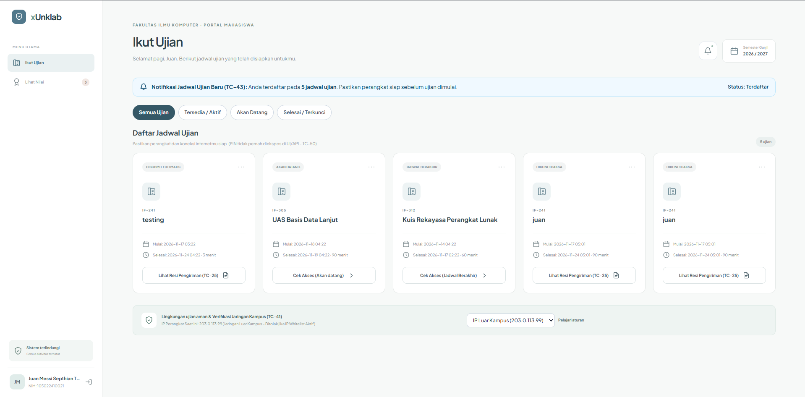

# xUnklab (SiLab Exam System)

Sistem informasi evaluasi akademik berbasis web untuk **Fakultas Ilmu Komputer, Universitas Klabat** yang membantu **Dosen** dan **Mahasiswa** menyelenggarakan serta mengikuti ujian daring secara aman, tersinkronisasi terpusat, dan terstruktur dengan proteksi **anti-curang tanpa kamera** agar integritas akademik tetap terjaga.



| | |
|---|---|
| **Mata kuliah** | System Analysis and Design — Fakultas Ilmu Komputer, Universitas Klabat |
| **Kelompok** | Final Project SAD (Informatika & Sistem Informasi) |
| **Objek / studi kasus** | Fakultas Ilmu Komputer (FILKOM), Universitas Klabat |
| **Dosen pengampu** | George M. W. Tangka, S.Kom., MBA |
| **Model SDLC** | Prototype / Agile Incremental |
| **Dokumen SRS** | [docs/SAD_FP_Kelompok_SRS.pdf](docs/) |
| **Prototipe UI** | [Figma Prototype — xUnklab Exam System](https://www.figma.com/make/gtLhi8jZA8qXw9if59lfFK/UI-xUnklab--SAD-?t=X5eCdlqS8fQNk7gD-1/) |

## Anggota Kelompok

| No | Nama | NIM | Peran | Kontribusi utama |
|----|------|-----|-------|------------------|
| 1 | Tulengkey, Juan Messi Septhian | 105022410021 | Project manager & Lead developer | Rencana kerja, arsitektur sistem, repository, integrasi backend & alur ujian (UC-01 s.d. UC-05) |
| 2 | Sumual, Valentino | 105022410095 | System analyst & UI/UX designer | Elisitasi kebutuhan, penyusunan SRS, spesifikasi anti-curang, desain UI web |
| 3 | Tuwaidan, Jeniffer Diana | 105022510107 | System designer & Frontend developer | Use Case diagram, Activity & Sequence diagram, integrasi antarmuka React & inline form cards |
| 4 | Sahetapy, Wilman Valentino | 105022410007 | Backend developer | Perancangan database MySQL, REST API Express, session lock terpusat, & trigger proteksi log |
| 5 | Laluyan, Matthew Arnold M | 105022510475 | QA dan dokumentasi | Pembuatan 53 skenario kasus uji (TC-01 s.d. TC-53), pengujian integrasi alur kerja, & README |

## Latar Belakang

- **Masalah:** Pelaksanaan ujian daring sering rentan terhadap kecurangan (berpindah tab browser, menyalin teks soal ke mesin pencari/AI, atau berbagi akun pada dua perangkat sekaligus), sementara penggunaan kamera pengawas memicu kendala privasi dan bandwidth mahasiswa.
- **Kondisi saat ini:** LMS atau formulir ujian konvensional umumnya belum memiliki proteksi aktif terhadap perpindahan tab, penguncian layar penuh (*fullscreen*), pembatasan IP jaringan kampus, *single-device lock*, maupun sinkronisasi status real-time antar perangkat.
- **Tujuan sistem:** Membangun platform ujian web terpadu dengan deteksi kecurangan berbasis event browser (*Fullscreen API*, *Page Visibility API*, *window blur*, pemblokiran *clipboard*), pengacakan soal & opsi jawaban, *auto-save* berkala, log pelanggaran *append-only* (*immutable*), serta sinkronisasi state terpusat di Backend Server (*Single Source of Truth*).
- **Pengguna (aktor):**
  - **Mahasiswa:** Mengikuti ujian dengan verifikasi PIN 6 digit, mengerjakan soal pada layar penuh anti-curang, memulihkan sesi apabila terputus, melihat resi pengiriman, dan memantau nilai setelah dipublikasikan.
  - **Dosen:** Mengelola bank soal (inline form card bergaya Google Forms), mengatur jadwal ujian (*alarm-style date & time picker*), mengelola peserta per mata kuliah, menambah waktu `+5 menit` real-time, menilai jawaban esai, meninjau log pelanggaran, dan mempublikasikan nilai.

## Fitur Utama

| No | Fitur | Aktor | Use case | Kebutuhan |
|----|-------|-------|----------|-----------|
| 1 | Login multi-peran, status akun terkunci, & *Single-Device Lock* | Mahasiswa, Dosen | UC-01 | FR-01, NFR-06 |
| 2 | Verifikasi PIN 6 digit, cek jadwal, & pembatasan IP jaringan kampus | Mahasiswa | UC-02 | FR-02, FR-03 |
| 3 | Pengerjaan ujian layar penuh, *auto-save*, & deteksi anti-curang tanpa kamera | Mahasiswa | UC-03, UC-04 | FR-04 s.d. FR-07 |
| 4 | Lihat nilai terpublikasi & resi bukti pengiriman resmi | Mahasiswa | UC-05 | FR-08 |
| 5 | Kelola Bank Soal (Inline Form Card & isolasi per ujian) | Dosen | UC-06 | FR-09, FR-10 |
| 6 | Atur Ujian & Buat Ujian Baru (*Alarm Date-Time Picker* & anti-duplikasi) | Dosen | UC-07 | FR-11, FR-12 |
| 7 | Kelola Peserta (filter per mata kuliah, tambah waktu `+5m`, konfirmasi inline) | Dosen | UC-08 | FR-13, FR-14 |
| 8 | Penilaian Esai manual, akumulasi Nilai Akhir, log pelanggaran *immutable*, & publikasi nilai | Dosen | UC-09, UC-10 | FR-15 s.d. FR-18 |

### Pembaruan Terbaru Sistem
- **Sinkronisasi Terpusat (Single Source of Truth):** State ujian, soal, peserta, sesi, dan log pelanggaran tersinkronisasi terpusat melalui `GET /api/state` & `POST /api/state/sync` (dengan persistensi `backend/data/session_sync_store.json`) beserta *cascade delete* saat ujian dihapus.
- **Anti-Duplikasi Ujian (`deduplicateExams`):** Mencegah data ujian ganda berdasarkan `id_ujian` maupun kombinasi `nama_ujian + kode_mk`.
- **Single-Device Login & Exam Lock (TC-05):** Pelacakan `active_user_sessions` (`device_id` + `last_heartbeat`) dan `active_exam_sessions` di backend menolak login dari perangkat kedua selama sesi perangkat pertama masih aktif, serta melepas kunci otomatis saat logout.
- **Inline Form Cards (Tanpa Pop-up Modal):** Form **Tambah/Edit Soal** di *Kelola Bank Soal* dan **Buat Ujian Baru** tampil menyatu penuh (`width: 100%`) bergaya Google Forms dengan opsi jawaban A–D vertikal.
- **Alarm-Style Date & Time Picker (TC-08 & TC-31):** Pemilih tanggal (`type="date"`), dropdown Jam (`00–23`) & Menit (`00–59`), serta tombol preset cepat (`Mulai Sekarang`, `Mulai +5 Menit Lagi`, `+90 Menit`, `+7 Hari`, `Set Sudah Berakhir -1 Menit Lalu`) pada layout 2 kolom lebar.
- **Sapaan Waktu Dinamis (*Real-Time Greeting*):** Dashboard Mahasiswa dan Dashboard Dosen menampilkan sapaan dinamis mengikuti jam perangkat (`Selamat pagi/siang/sore/malam`).

## Screenshot

**[UC-01] Login Portal Dosen & Portal Mahasiswa**


**[UC-02] Verifikasi PIN Ujian 6 Digit (Mahasiswa)**


**[UC-05] Lihat Hasil Ujian & Status Penilaian**


**[UC-06] Kelola Bank Soal & Tambah Soal (Inline Form Card)**


**[UC-07] Atur Ujian & Validasi Pengaturan**


**[UC-08] Kelola Peserta Ujian & Konfirmasi Hapus Inline**


**[UC-09] Tinjau Log Pelanggaran (Append-Only / Immutable)**


**[UC-10] Tetapkan Keputusan & Sanksi Pelanggaran**


**[UC-19] Menerima Bukti Pengiriman Ujian (Resi Resmi)**


## Teknologi

| Lapisan | Teknologi | Versi |
|---------|-----------|-------|
| Front-end | React, TypeScript, Vite, Lucide React | React 19, Vite 8 |
| Back-end | Node.js, Express.js, Helmet, CORS, bcryptjs, JWT | Node 20+, Express 4.19+ |
| Database | MySQL 8.0 (InnoDB, `utf8mb4`) + JSON/In-Memory Sync Store Fallback | MySQL 8.0 |
| Tools pemodelan | Draw.io, StarUML, PlantUML | — |
| Prototipe UI | Figma | — |

## Kebutuhan Sistem

- **Node.js** v18 atau lebih baru (disarankan v20+) & `npm`
- **MySQL 8.0** atau XAMPP *(opsional; backend mendukung graceful JSON/in-memory fallback jika MySQL tidak aktif)*
- **Git**
- Browser modern (Google Chrome, Microsoft Edge, Firefox, atau Safari)

## Instalasi dan Menjalankan Aplikasi

1. Clone repository:

   ```bash
   git clone https://github.com/juanmessi16/sad-final-project.git
   cd sad-final-project
   ```

2. Pasang dependensi dan siapkan konfigurasi Backend:

   ```bash
   cd backend
   npm install
   cp .env.example .env
   ```

   Sesuaikan isi `backend/.env` bila perlu (`PORT=5000`, `DB_HOST=127.0.0.1`, `DB_NAME=xunklab_db`).

3. Siapkan database MySQL *(opsional jika menggunakan MySQL)* dan jalankan Backend:

   ```bash
   npm run migrate
   npm start
   ```

   Server REST API berjalan di `http://localhost:5000`.

4. Buka terminal baru, pasang dependensi, dan jalankan Frontend:

   ```bash
   cd frontend
   npm install
   npm run dev
   ```

   Untuk build produksi frontend:

   ```bash
   cd frontend
   npm run build
   ```

5. Buka `http://localhost:5173` di browser.

### Akun uji

| Aktor | Username / NIM / NIP | Password | Keterangan |
|-------|----------------------|----------|------------|
| **Dosen** | `george` / `198501012010011001` | `123` | George M. W. Tangka, S.Kom., MBA (Portal Dosen) |
| **Mahasiswa 1** | `105022410021` | `123` | Tulengkey, Juan Messi Septhian *(Data uji esai belum dinilai)* |
| **Mahasiswa 2** | `105022510107` | `123` | Tuwaidan, Jeniffer Diana *(Data uji esai sudah dinilai)* |
| **Mahasiswa 3** | `105022410095` | `123` | Sumual, Valentino *(Data uji sanksi -20 poin)* |
| **Mahasiswa 4** | `105022410007` | `123` | Sahetapy, Wilman Valentino |
| **Mahasiswa 5** | `105022510475` | `123` | Laluyan, Matthew Arnold M |
| **Akun Terkunci** | `terkunci` | `123` | Akun uji status `Terkunci` (TC-04) |

> **PIN Ujian Default:** `483920` (6 digit)

## Struktur Folder

```text
sad-final-project/
├── backend/
│   ├── data/
│   │   └── session_sync_store.json   # Persistensi sinkronisasi state & session lock
│   ├── database/
│   │   ├── schema.sql                # DDL tabel, foreign key, & trigger immutable log
│   │   └── seed.sql                  # Data contoh awal
│   ├── scripts/
│   │   ├── migrate.js                # Skrip migrasi MySQL
│   │   └── backup.js                 # Skrip backup database
│   ├── src/
│   │   ├── config/db.js              # Connection pool MySQL & transaksi SQL
│   │   ├── controllers/              # Logika use case (auth, ujian, sesi, anti-curang, hasil, dosen)
│   │   ├── middlewares/              # JWT (<= 3 jam), RBAC 403, HTTPS redirect, IP whitelist
│   │   ├── routes/                   # Rute REST API modular
│   │   └── utils/                    # sessionStore.js, autoGrader.js, randomizer.js, idGenerator.js
│   ├── .env.example
│   ├── package.json
│   └── server.js                     # Entry point Express REST API
├── frontend/
│   ├── src/
│   │   ├── ui-lib/
│   │   │   ├── App.tsx               # Portal Mahasiswa, Portal Dosen, & ExamPage
│   │   │   ├── apiClient.ts          # Klien API terpadu, deduplikasi, & sinkronisasi backend
│   │   │   └── index.css             # Design system & styling layout
│   │   ├── hooks/                    # useAntiCheat, useAutoSave
│   │   ├── pages/                    # Komponen halaman modular
│   │   └── services/                 # Adapter API & storage
│   ├── ui/                           # Prototipe alternatif berbasis Python (Tkinter/SimpleHTTP)
│   └── package.json
├── media/                            # Screenshot antarmuka aplikasi
└── README.md
```

## Rancangan Sistem

Ringkasan rancangan; detail lengkap ada di dokumen SRS.

| Artefak | Lokasi |
|---------|--------|
| Kebutuhan fungsional dan non-fungsional | SRS Bagian 5 |
| Use case diagram dan description | SRS Bagian 6 |
| Activity dan sequence diagram | SRS Bagian 6.4 dan 7.1 |
| Class diagram | SRS Bagian 7.2 |
| Model data (ERD) dan kamus data | SRS Bagian 8 |
| Prototipe UI | [Figma Prototype — xUnklab Exam System](https://www.figma.com/make/gtLhi8jZA8qXw9if59lfFK/UI-xUnklab--SAD-?t=X5eCdlqS8fQNk7gD-1/) |

## Pengujian

Ringkasan: **53 kasus uji (TC-01 s.d. TC-53), seluruh skenario inti terverifikasi pada alur Backend & Frontend**.

| ID | Use case | Skenario | Hasil diharapkan | Status |
|----|----------|----------|------------------|--------|
| TC-01 | UC-01 | Login dengan NIM/username & password benar | Masuk ke dashboard sesuai peran | Lulus |
| TC-03 | UC-01 | Login dengan password salah | Pesan kesalahan tampil, akses ditolak | Lulus |
| TC-04 | UC-01 | Login dengan akun berstatus `Terkunci` | Ditolak dengan status `403 Forbidden` | Lulus |
| TC-05 | UC-01 / UC-02 | Login atau buka ujian dari perangkat kedua bersamaan | Perangkat kedua ditolak (*Single-Device Lock*) | Lulus |
| TC-06 | UC-02 | Masukkan PIN 6 digit salah (`pin_ujian`) | Ujian tidak dimulai, pesan error PIN tampil | Lulus |
| TC-08 & TC-31 | UC-02 / UC-07 | Akses ujian sebelum jadwal mulai atau setelah jadwal selesai | Akses ditolak dengan keterangan waktu server | Lulus |
| TC-27 & TC-28 | UC-05 / UC-10 | Dosen menonaktifkan/mengaktifkan publikasi hasil ujian | Mahasiswa melihat `"Belum dinilai"` vs nilai akhir | Lulus |
| TC-29 & TC-30 | UC-06 | Tambah/edit soal objektif tanpa kunci jawaban | Validasi menolak simpan hingga kunci jawaban diisi | Lulus |
| TC-32 | UC-07 | Simpan ujian dengan durasi `<= 0` menit | Validasi menolak dengan pesan error TC-32 | Lulus |
| TC-34 & TC-42 | UC-08 | Akses ujian oleh non-peserta & tambah waktu `+5m` real-time | Non-peserta ditolak; peserta mendapat `+5 menit` | Lulus |
| TC-40 | UC-09 | Input nilai esai (`0–100`) & akumulasi nilai akhir | Nilai akhir terhitung & status menjadi `"Selesai Dinilai"` | Lulus |
| TC-52 | UC-09 | Upaya ubah/hapus `log_pelanggaran` | Ditolak trigger SQL & HTTP `403` (*immutable*) | Lulus |

## Keterbatasan dan Pengembangan Berikutnya

- Jika server MySQL lokal tidak diaktifkan, backend berjalan menggunakan penyimpanan fallback JSON (`backend/data/session_sync_store.json`) untuk menjaga sinkronisasi lintas browser tetap aktif.
- Simulasi pembatasan IP jaringan kampus (`TC-41`) mendukung header uji `X-Simulated-IP` untuk keperluan demonstrasi di luar jaringan fisik kampus.
- Pengembangan berikutnya: integrasi SSO Universitas Klabat, ekspor rekap nilai ke format `.xlsx`/`.pdf`, dan notifikasi *push* berbasis WebSocket.

## Penggunaan AI dan Referensi

| Alat AI | Dipakai untuk | Yang diperiksa atau diubah dari hasilnya |
|---------|---------------|------------------------------------------|
| Antigravity AI Assistant | Membantu implementasi sinkronisasi state terpusat, *single-device lock*, inline form cards, *alarm date-time picker*, dan perapihan dokumentasi | Memverifikasi seluruh endpoint API, logika deduplikasi ujian, hasil `vite build`, dan kesesuaian terhadap 53 kasus uji SRS |

Referensi:

1. React Documentation — https://react.dev/
2. Express.js Documentation — https://expressjs.com/
3. Vite Documentation — https://vite.dev/
4. MySQL 8.0 Reference Manual — https://dev.mysql.com/doc/refman/8.0/en/
